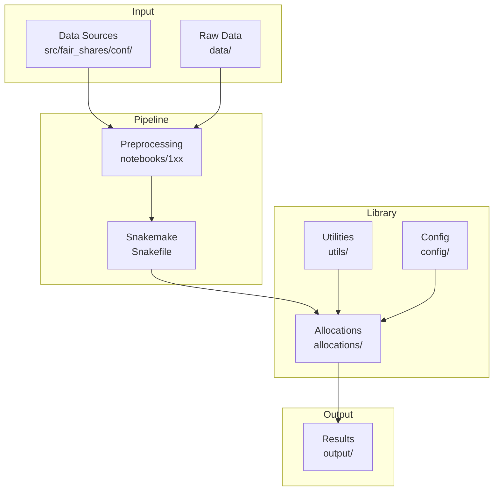

# Developer Guide

This guide explains the fair-shares architecture and how to extend the library.

---

## Architecture Overview

> **For a detailed end-to-end walkthrough with worked examples**, see the [Architecture Walkthrough](architecture-walkthrough.md).



---

## Key Modules

| Module            | Location                                  | Responsibility                                                    |
| ----------------- | ----------------------------------------- | ----------------------------------------------------------------- |
| **Allocations**   | `src/fair_shares/library/allocations/`    | Core allocation functions                                         |
| **Utilities**     | `src/fair_shares/library/utils/`          | Data manipulation, adjustments                                    |
| **Config**        | `src/fair_shares/library/config/`         | Pydantic models                                                   |
| **Preprocessing** | `src/fair_shares/library/preprocessing/`  | Reusable logic for the 100-series preprocessing notebooks         |
| **Pipeline**      | `src/fair_shares/library/pipeline/`       | Composite, RCB, pathway and non-CO2 preprocessing runners         |
| **IAMC history**  | `src/fair_shares/library/iamc_historical/` | Back-fills IAM scenarios with IAMC-consistent historical emissions |
| **Python API**    | `src/fair_shares/library/python_api.py`   | Computes allocation timeseries in memory, without notebooks       |
| **Data fetch**    | `src/fair_shares/library/data_fetch.py`   | Downloads registry files and checks their checksums               |
| **Citations**     | `src/fair_shares/library/citations.py`    | Derives and formats the citations a run needs                     |
| **Data registry** | `src/fair_shares/library/data_registry.py` | Reads and checks `conf/data_registry.yaml` (source, licence, citation) |
| **Notebooks**     | `notebooks/1xx_*.py`                      | Data pipeline notebooks                                           |

---

## Allocations Module

### Structure

```
allocations/
├── __init__.py
├── budgets/
│   ├── __init__.py
│   └── per_capita.py      # Budget allocation functions
├── pathways/
│   ├── __init__.py
│   ├── per_capita.py      # Pathway allocation functions
│   ├── per_capita_convergence.py
│   └── cumulative_per_capita_convergence.py
├── results/               # Result dataclasses
├── core.py               # Shared logic
└── manager.py            # Orchestration + approach name → function registry
```

### Entry Points

**Direct function calls:**

```python
from fair_shares.library.allocations.budgets import equal_per_capita_budget

result = equal_per_capita_budget(
    population_ts=population_df,
    allocation_year=2020,
    emission_category="co2-ffi",
)
```

**Manager functions (high-level):**

```python
from fair_shares.library.allocations import run_parameter_grid

results = run_parameter_grid(
    allocations_config=config,
    population_ts=population_df,
    # ...
)
```

### Result Types

| Type                      | Module                | Description                     |
| ------------------------- | --------------------- | ------------------------------- |
| `BudgetAllocationResult`  | `allocations.results` | Single cumulative allocation    |
| `PathwayAllocationResult` | `allocations.results` | Time-varying annual allocations |

`BudgetAllocationResult` contains `relative_shares_cumulative_emission`; `PathwayAllocationResult` contains `relative_shares_pathway_emissions`. Both sum to 1.0 and provide methods to compute absolute emissions.

---

## Adding New Functionality

All allocation approaches in this library can be linked to specific (sets of) equity principles. Before contributing new approaches, review the [From Principle to Code](../science/principle-to-code.md) documentation to understand the normative foundations.

Use the **Entry Points Framework** when considering any new approach: (1) foundational principles, (2) allocation quantity, (3) allocation approach, (4) indicators, (5) implications for all others [Pelz 2025b](https://doi.org/10.1088/1748-9326/ada45f).

In particular, avoid:

- **Claiming value neutrality** — all allocation choices embed normative judgments [Dooley 2021](https://doi.org/10.1038/s41558-021-01015-8); [Kartha 2018](https://doi.org/10.1038/s41558-018-0152-7)
- **Including grandfathering** — it has no philosophical support and contradicts equity purposes [Dooley 2021](https://doi.org/10.1038/s41558-021-01015-8); [Kartha 2018](https://doi.org/10.1038/s41558-018-0152-7)
- **Combining contradictory principles** — produces incoherent results [Dooley 2021](https://doi.org/10.1038/s41558-021-01015-8)

### Guides

- **[Adding Allocation Approaches](adding-approaches.md)** — implementing new equity principles
- **[Adding Data Sources](adding-data-sources.md)** — integrating new datasets

---

## Conventions

### Year Columns as Strings

**Critical:** Year columns must be strings, not integers.

```python
# Correct
df["2020"]

# Incorrect
df[2020]
```

Always call `ensure_string_year_columns(df)` after loading data.

### Kebab vs Snake Case

| Context               | Style      | Example                   |
| --------------------- | ---------- | ------------------------- |
| Config/approach names | kebab-case | `equal-per-capita-budget` |
| Python identifiers    | snake_case | `equal_per_capita_budget` |

### Index Structure

DataFrames use MultiIndex with standard levels:

| Data Type      | Index Levels                         |
| -------------- | ------------------------------------ |
| Emissions      | `iso3c`, `unit`, `emission-category` |
| GDP/Population | `iso3c`, `unit`                      |
| Gini           | `iso3c`, `unit`                      |

---

## Testing

```bash
# Run all tests
uv run pytest tests/

# Run specific test module
uv run pytest tests/unit/allocations/

# Run with coverage
uv run pytest --cov=fair_shares tests/
```

---

## Code Quality

```bash
# Lint
uv run ruff check src/ tests/

# Format
uv run ruff format src/ tests/
```

---

## Documentation Workflow

Run these checks before you commit documentation changes:

```bash
# Build the site; warnings fail the build (broken links, missing pages)
uv run mkdocs build --strict

# Run the test suite
uv run pytest tests/

# Run the pre-commit hooks (ruff, ruff-format, interrogate docstring coverage)
uv run pre-commit run --all-files
```

---

## See Also

- **[Architecture Walkthrough](architecture-walkthrough.md)** - End-to-end code path walkthrough with worked examples
- **[API Reference](../api/index.md)** - Function documentation
- **[Scientific Documentation](../science/allocations.md)** - Theoretical foundations
