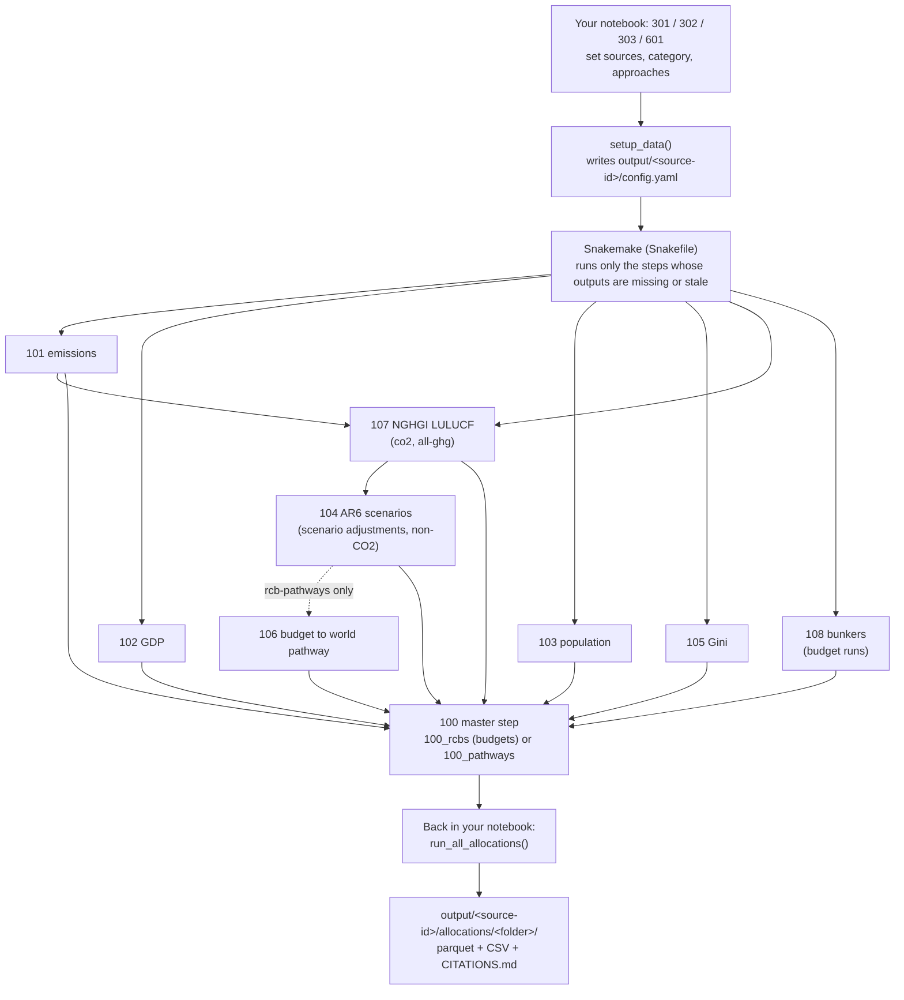

# What happens where

This page follows one allocation run from raw input files to saved results.
Each row names the notebook that does the work, the library code behind it, and the files it writes.
Use it to find where a number comes from, or where to change a step.

## The run in one picture

You run one notebook. That notebook calls `setup_data()`, which writes a run configuration and calls Snakemake.
Snakemake runs the preprocessing notebooks in the order their inputs require.
Control then returns to your notebook, which runs the allocations and saves the results.

## Step by step

### 1. Configuration

| What | Where | Writes |
| --- | --- | --- |
| Choose sources, emission category, target, approaches | Top cells of notebook 301, 302, 303 or 601 | (in memory) |
| Validate the choices, compose the run config | `setup_data()` in `library/utils/data/setup.py`; rule `compose_config` | `output/<source-id>/config.yaml` |
| Source definitions and defaults | `src/fair_shares/conf/data_sources/data_sources_unified.yaml` | |
| Budget sources and rebase settings | `data/rcbs/rcbs.yaml` | |
| Step order and which notebook runs for which settings | [`Snakefile`](https://github.com/setupelz/fair-shares/blob/main/Snakefile) | |
| Input file versions, checksums, licences | `src/fair_shares/conf/data_registry.yaml`; `fair-shares fetch-data` | `data/PROVENANCE.md` |

The `<source-id>` folder name joins the active sources, the target and the category, for example `primap-202503_wdi-2025_un-owid-2025_wdi-2025_rcbs_co2-ffi`.
Two runs with different sources therefore never overwrite each other.

### 2. Preprocessing (run by Snakemake)

Notebooks with a source name in the file name come in one copy per source. The Snakefile picks the copy that matches the active source.

| Notebook | Snakemake rule | Runs when | Does | Writes (under `output/<source-id>/intermediate/`) |
| --- | --- | --- | --- | --- |
| `101_data_preprocess_emiss_<source>` | `preprocess_emiss` | always | Reads historical emissions (PRIMAP-hist or GCB 2025) and builds one series per emission category | `emissions/emiss_<category>_timeseries.csv` |
| `102_data_preprocess_gdp_<source>` | `preprocess_gdp` | always | GDP in constant 2017 PPP dollars (World Bank WDI) | `gdp/gdp_timeseries.csv` |
| `103_data_preprocess_population_<source>` | `preprocess_population` | always | Population history and UN WPP 2024 projections | `population/population_timeseries.csv` |
| `105_data_preprocess_gini_<source>` | `preprocess_gini` | always | Gini index (WDI by default, WIID opt-in) | `gini/gini_stationary.csv` |
| `107_derive_nghgi_categories_<source>` | `preprocess_lulucf` | category `co2` or `all-ghg` | Adds national-inventory (NGHGI) land-use CO2 from the LULUCF Data Hub. Builds `co2`, `non-co2` and `all-ghg` history | `emissions/emiss_co2_timeseries.csv` and related files |
| `108_data_preprocess_bunkers_<source>` | `preprocess_bunkers` | budget targets | International aviation and shipping CO2 from the Global Carbon Budget | `emissions/bunker_timeseries.csv` |
| `104_data_preprocess_scenarios_ar6` | `preprocess_scenarios` and related rules | scenario-based targets, all budget runs with `active_scenario_source: ar6`, and every multi-gas run | AR6 scenario pathways, harmonised to history. Gives the future land-use and bunker terms for budget rebasing, and the non-CO2 pathways | `scenarios/scenarios_<category>_timeseries.csv`, `scenarios/rcb_scenario_adjustments.yaml` |
| `106_generate_pathways_from_rcbs` | `generate_rcb_pathways` | target `rcb-pathways` | Turns a global budget into a world pathway (exponential decay by default) | `scenarios/scenarios_<category>_timeseries.csv` |
| `100_data_preprocess_rcbs` | `master_preprocess` | budget targets | Joins all inputs, fixes the analysis-country set and rest of world, rebases each budget to 2020 | `processed/rcbs_<category>.csv`, `processed/country_*.csv`, `processed/world_*.csv`, `processed/country_data_coverage_summary.csv` |
| `100_data_preprocess_pathways` | `master_preprocess` | pathway targets, and the non-CO2 part of multi-gas runs | The same join, for annual pathways | `processed/...` |

The master step calls the library functions in `library/pipeline/preprocessing.py` (`run_rcb_preprocessing`, `run_pathway_preprocessing`, `run_non_co2_preprocessing`).
Budget rebasing lives in `library/utils/data/rcb.py`. The analysis-country rule lives in `library/preprocessing/coverage.py`, and rest of world in `library/preprocessing/row.py`.
The [Other Operations](../science/other-operations.md) page explains the rebasing, the NGHGI corrections and the multi-gas split.

### 3. Allocation (back in your notebook)

| What | Where |
| --- | --- |
| Load the processed inputs | `load_allocation_data()` in `library/notebook_helpers.py` |
| Expand the parameter grid, run every approach | `run_all_allocations()` in `library/notebook_helpers.py`, which calls `run_allocation()` in `library/allocations/manager.py` |
| Approach registry (name to function) | `get_allocation_functions()` in `library/allocations/manager.py` |
| Budget approaches | `library/allocations/budgets/per_capita.py` |
| Pathway approaches | `library/allocations/pathways/` |
| Shared maths (adjustments, convergence) | `library/utils/math/` |
| Save results with metadata | `library/allocations/results/` |

Results land in `output/<source-id>/allocations/<allocation_folder>/` as parquet and wide CSV, together with the run's `CITATIONS.md`.
The column meanings are in [Output Schema](output-schema.md).

### 4. Remaining budgets and annual pathways (notebook 601 and the Python API)

Notebook 601 goes two steps further than the allocation itself.
Section 5 subtracts each country's observed emissions from its allocated budget, which gives the budget remaining from 2024.
Section 6 spreads each remaining budget into an annual pathway to 2100.
The same two steps are available without the notebook through `calculate_allocation_timeseries()` in `library/python_api.py` ([Python API](../api/python-api.md)).
A test (`tests/integration/test_python_api_reproduces_notebook.py`) checks that the notebook and the API give the same numbers.

## The IAM-region route (400 series)

| Notebook | Does | Writes |
| --- | --- | --- |
| `400_data_preprocess_scenario_for_allocation` | Reads a raw IAMC scenario file, adds regional history for emissions, population and GDP, builds `Emissions|Covered` | `output/iamc/iamc_covered.xlsx` |
| `401_custom_iamc_allocation` | Your own IAM-region allocation; also exports a model-ready budget | `output/iamc/...` |
| `402_example_iamc_budget_allocations`, `403_example_iamc_pathway_allocations` | Worked examples | `output/iamc/...` |

The history back-fill lives in `library/iamc_historical/`.
These notebooks run outside Snakemake. Run 400 first.

## Reproductions of published studies (600 series)

| Notebook | Study | Status |
| --- | --- | --- |
| `601_reproduce_esabcc_2023` | ESABCC (2023) and the underlying IIASA study, Pelz, Rogelj and Riahi (2023) | Same approaches and parameters, current data. Differences listed in [ESABCC 2023 and what changed since](../science/esabcc-and-updates.md) |
| `602_reproduce_dekker_2025` | Dekker et al. (2025) | Four of six approaches, expressed in library terms |
| `604_reproduce_vandenberg_2020` | van den Berg et al. (2020) | Effort-sharing approaches, expressed in library terms |
| `605_reproduce_matthews_2016` | Gignac and Matthews (2015), Matthews (2016) | Carbon-debt formulation, expressed in library terms |

These notebooks show that the library can express each study's method.
Each one lists the input differences that would have to be removed before its numbers could match the study's published figures.
